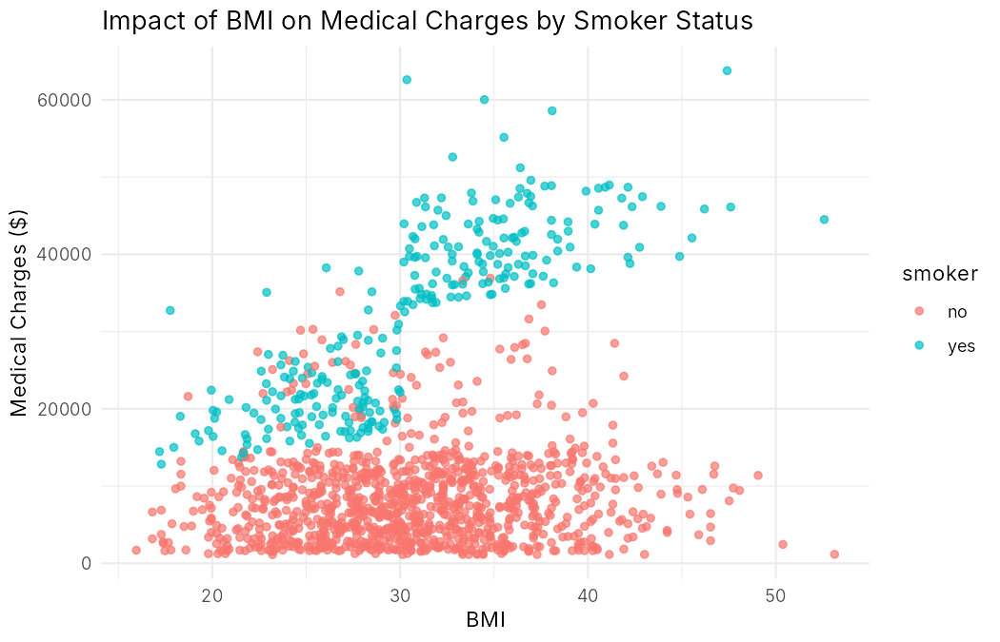
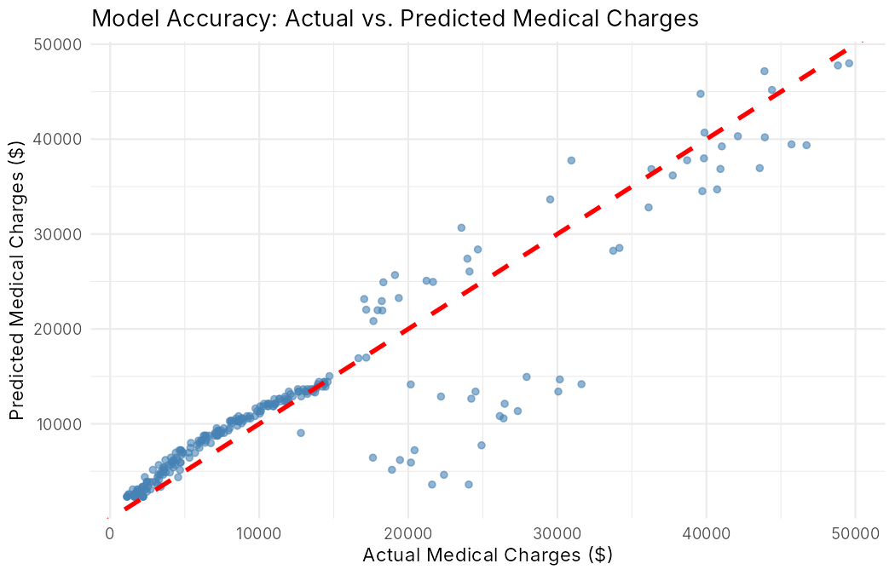

# Healthcare Insurance Cost Analysis

Exploratory data analysis and a multiple linear regression model that predicts individual medical insurance charges from patient demographics and health factors. Built in R with Quarto.

## Results

- **Smoking is the dominant cost driver.** It has a correlation of 0.79 with charges, far ahead of age (0.30) and BMI (0.20).
- **BMI matters mostly for smokers.** Charges for non-smokers stay fairly flat as BMI rises, while smokers with a BMI above 30 see a sharp jump in costs. The model captures this with a `bmi × smoker` interaction term.
- **Region and number of children are weak predictors.** Median charges are similar across regions, and average charges don't fall as the number of children rises.
- **Model performance:** on a held-out 20% test set, the model achieves a **mean absolute error of $2,688.95** (R² = 0.84 on the training set).



The model is accurate for charges below about $15,000 and captures the high-cost smoker cases, but struggles in the $20,000–$30,000 range, which suggests factors not in the data (such as specific diagnoses) explain the remaining variance.



## Approach

1. **Univariate analysis** of charges, BMI, age, and each categorical variable
2. **Bivariate analysis** of charges against age, BMI, region, and children, split by smoker status
3. **Correlation matrix** with smoker status encoded as 0/1
4. **Modeling:** multiple linear regression `charges ~ age + children + bmi * smoker` on an 80/20 train-test split (`set.seed(123)`)
5. **Evaluation:** mean absolute error and an actual-vs-predicted plot on the test set

## Data

`data/insurance.csv` contains 1,338 records with 7 columns: `age`, `sex`, `bmi`, `children`, `smoker`, `region`, and `charges`. It is the widely used public Medical Cost Personal dataset.

## How to run

Requires R and [Quarto](https://quarto.org).

```r
install.packages(c("tidyverse", "ggcorrplot"))
```

Then open `healthcare-insurance-eda.Rproj` in RStudio and render `healthcare-insurance-eda.qmd`, or from a terminal:

```bash
quarto render healthcare-insurance-eda.qmd
```

## Tools

R · tidyverse (dplyr, ggplot2) · ggcorrplot · Quarto
